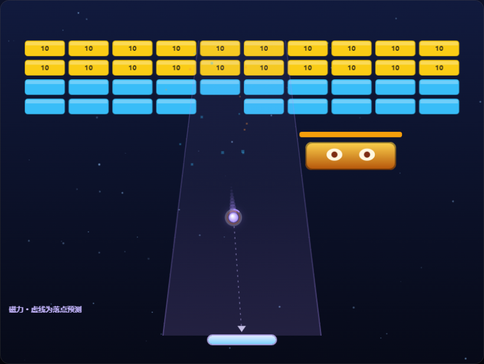
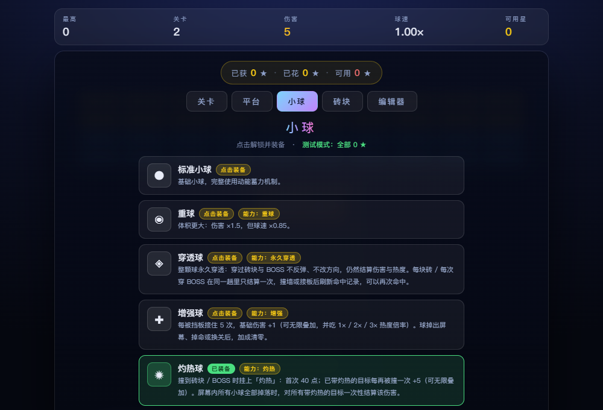

# Kinetic Ball · 弹力球打砖块


> 零依赖、单文件的 HTML5 Canvas 打砖块游戏：动能蓄力、天赋解锁、特殊球 / 挡板、BOSS，以及内置的砖块 / 小球 / 挡板 / 关卡编辑器。
>
> A zero-dependency, single-file Canvas breakout game with kinetic charge, talents, special balls & paddles, a boss, and a built-in content editor.





> **当前仓库为测试模式：所有装备解锁价都是 `0 ★`**，点击卡片并确认即可解锁 / 装备，方便直接体验全部内容。
> 想恢复正式价格，只需修改 `TALENT_COST` 与 `TALENT_COST_DEFAULT`，详见[星星与天赋](#星星与天赋)。

---

## 目录

- [快速开始](#快速开始)
- [操作方式](#操作方式)
- [玩法与机制](#玩法与机制)
- [特殊装备](#特殊装备)
- [星星与天赋](#星星与天赋)
- [内容一览](#内容一览)
- [自定义内容编辑器](#自定义内容编辑器)
- [技术架构](#技术架构)
- [项目结构](#项目结构)
- [扩展指南](#扩展指南)
- [存档与兼容性](#存档与兼容性)
- [已知限制](#已知限制)
- [更新日志](#更新日志)
- [License](#license)
- [English Overview](#english-overview)

---

## 快速开始

```bash
git clone https://github.com/WMSshl/kinetic_ball.git
cd kinetic_ball
```

然后直接打开 `index.html`：

- Windows：双击 `index.html`，或 `start index.html`
- macOS：`open index.html`
- Linux：`xdg-open index.html`

不需要安装依赖、不需要构建、不需要后端。游戏是**单个 HTML 文件**，所有逻辑、样式、音效和绘制都在里面。

如果浏览器对 `file://` 下的本地存档有限制，可以在项目目录启动一个静态服务器：

```bash
python -m http.server 8000
# 打开 http://localhost:8000
```

### GitHub Pages

仓库设置 → **Pages** → **Deploy from a branch** → 选择 `main` / `(root)`，保存后即可通过：

```text
https://wmshl.github.io/kinetic_ball/
```

访问。`index.html` 已经是入口文件，不需要额外配置。

---

## 操作方式

| 操作 | 按键 / 鼠标 |
|---|---|
| 移动挡板 | `←` / `→`、`A` / `D`，或鼠标 / 触摸移动 |
| 发射小球 | `空格`，或鼠标左键 |
| 弹射挡板主动技能 | 鼠标左键 / `J` |
| 激光挡板开火 | **长按**鼠标左键 / `J`（小球在飞行中时） |
| 暂停 | `P` / `Esc` |
| 重开本关 | `R` |
| 静音 | `M` |

> 左键同时承担「发射」和「挡板主动技能」两个职责；小球还没发射时点击是发射，发射后点击 / 长按才会触发挡板能力。

---

## 玩法与机制

### 目标

移动挡板接住小球，击碎场上的砖块。有 BOSS 的关卡需要**清空砖块并击败 BOSS**才算通关。共有 3 条命；屏幕内小球全部掉落时扣 1 条命并重新发球。

### 动能蓄力

小球连续命中砖块 / BOSS、且不碰挡板时，会积累**热度**：

| 热度档位 | 基础伤害 | 球速 |
|---|---|---|
| 1 档（0–8 热度） | 5 | 1.00×–1.44× |
| 2 档（9–17 热度） | 10 | 1.50×–1.94× |
| 3 档（18 热度） | 15 | 2.00× |

- 每命中一次砖块 / BOSS 增加热度；接住小球会衰减热度并清空连击计数。
- 球速随热度提升，最高约为初始速度的 2 倍。
- 弹射挡板的主动技能会在接球时额外提供 `+6 热度` 与 `+4 加速度`，约 1.3 秒衰减完。
- 顶部的「伤害 / 球速」会显示当前场上小球的实际数值。

### 生命与掉球

- 初始 3 条命。
- 所有小球都掉出屏幕底部时扣 1 条命；如果此时还有砖块或 BOSS，会重置一颗待发射的小球。
- 掉命会清空连击、激光连击、随机挡板计数等回合状态。

### 星星评价

每关按掉命次数结算：

| 掉命次数 | 星星 |
|---|---|
| 0 次 | ★★★ |
| 1 次 | ★★☆ |
| 2 次及以上 | ★☆☆ |

每关只记录历史最好成绩。星星是天赋解锁货币，但**当前测试模式所有装备价格为 0**，所以星星只作为进度 / 挑战记录保留。

### BOSS

当前内置 1 种标准 BOSS：

- 尺寸 150 × 46，在顶部左右巡逻。
- 血量：`200 + 20 × 关卡等级`。
- 定期向下发射子弹；子弹命中挡板会让挡板变窄 4 秒。
- 血量低于 40% 进入狂暴：移动更快、开火更频繁。
- 击破后掉落 3 个道具（G / M / E）。
- 灼热、穿透、激光等所有伤害机制对 BOSS 都生效。

### 掉落道具

普通砖块有 16% 概率掉落道具；礼物砖必定掉落；BOSS 击破掉落 3 个。

| 道具 | 效果 |
|---|---|
| `E` 加宽挡板 | 挡板加宽 9 秒 |
| `M` 分裂多球 | 从现有小球分裂出额外小球（受 8 球上限限制） |
| `S` 小球减速 | 小球速度降低 7 秒 |
| `L` 增加生命 | 生命 +1（上限 6） |
| `G` 激光炮台 | 挡板两侧获得激光 5 秒 |

---

## 特殊装备

所有装备都在「选关 → 平台 / 小球」中解锁并装备。**当前测试模式全部为 0 ★**；表格最后一列是恢复正式收费时的参考价。

### 小球

| 装备 | 效果 | 关键参数 | 正式参考价 |
|---|---|---|---|
| 标准小球 | 基础小球 | 伤害 ×1、速度 ×1 | 免费 |
| 重球 | 体积更大、伤害更高、速度更慢 | 半径 11、伤害 ×1.5、速度 ×0.85 | 1 ★ |
| 穿透球 | **永久穿透**砖块与 BOSS；不反弹、不改方向，仍结算伤害与热度 | 每块砖 / 每次穿 BOSS 在同一趟只结算一次；撞墙或接板后刷新命中记录 | 3 ★ |
| 增强球 | 每被挡板接住 5 次，基础伤害 +1，可无限叠加 | `per=5, add=1`；掉球 / 掉命 / 换关清零；吃热度倍率 | 3 ★ |
| 灼热球 | 命中挂「灼热」：首次 40 点，已带灼热的目标每再撞一次 +5 | `dmg=40, stack=5`；屏幕内小球**全部掉落**时统一结算 | 3 ★ |

### 挡板

| 装备 | 效果 | 关键参数 | 正式参考价 |
|---|---|---|---|
| 标准挡板 | 基础挡板 | 宽 112 | 免费 |
| 弹射挡板 | 左键 / J 激活弹性增强 | 持续 0.20 秒、冷却 0.30 秒；接球 +6 热度、+4 加速度 | 3 ★ |
| 宽挡板 | 天生更宽，无主动能力 | 宽 165 | 3 ★ |
| 磁力挡板 | 全屏吸引下落中的小球，并显示虚线落点预测 | 吸力为原版 **50%**（`MAGNET_SCALE=0.5`）；越靠近挡板越强；落点箭头 | 3 ★ |
| 随机挡板 | 每接住 5 次，从挡板中心额外弹出 2 颗随机类型小球 | `per=5, count=2`；受 8 球上限限制；掉命重置计数 | 3 ★ |
| 激光挡板 | 小球飞行时，长按左键 / J 从挡板**正中间**连发激光 | 基础伤害 1；每命中 12 次升一档，伤害 ×2 / ×3；2 秒无有效命中则断连击 | 3 ★ |
| 穿透挡板 | 每次发球获得一次穿透，穿砖块 / BOSS 不反弹 | 撞到任意墙壁后失效；下次发球重新获得 | 3 ★ |

### 组合示例

- **灼热球 + 磁力挡板**：磁力把球吸向挡板，延长回合；灼热在掉球时集中引爆。
- **穿透球 + 激光挡板**：穿透球负责持续穿砖，激光负责补刀和清残血。
- **增强球 + 弹射挡板**：快速接球叠层，同时利用弹射的热度加成。
- **随机挡板 + 任意球**：5 次接球后召出穿透 / 增强 / 灼热球，适合多球滚雪球。

---

## 星星与天赋

### 当前价格：全部 0 ★

`TALENT_COST` 当前为：

```js
const TALENT_COST = {
  paddle: { classic: 0, bouncy: 0, wide: 0, magnet: 0, random: 0, laser: 0, pierce: 0 },
  ball:   { classic: 0, heavy: 0, pierceBall: 0, stackBall: 0, burnBall: 0 }
};
const TALENT_COST_DEFAULT = 0;
```

因此 0 星星也能解锁所有装备，自定义内容的默认价也是 0。

### 恢复正式价格

只需改 `index.html` 里的这两处：

```js
const TALENT_COST = {
  paddle: { classic: 0, bouncy: 3, wide: 3, magnet: 3, random: 3, laser: 3, pierce: 3 },
  ball:   { classic: 0, heavy: 1, pierceBall: 3, stackBall: 3, burnBall: 3 }
};
const TALENT_COST_DEFAULT = 3;
```

- `classic` 建议保持 0（基础装备免费自带）。
- 重球参考价 1 ★，其余挡板 / 小球参考价 3 ★。
- 自制内容如果没有单独设置 `cost`，会使用 `TALENT_COST_DEFAULT`。
- 天赋卡上的价格、解锁确认、星星余额都会自动跟着这张表变化，不需要改 UI 代码。

### 重置行为

- **重置进度（保留自制）**：清空关卡进度、星星、已解锁天赋；自建的砖块 / 小球 / 挡板 / 关卡保留。
- **清空自制内容…**：删除全部自建内容，并重置进度；删除前会自动在回收站留一份备份。

---

## 内容一览

### 砖块

| 名称 | 血量 | 分值 | 能力 |
|---|---|---|---|
| 软砖 | 5 | 10 | — |
| 中砖 | 10 | 20 | — |
| 硬砖 | 15 | 30 | — |
| 钢砖 | 25 | 45 | — |
| 爆破砖 | 5 | 25 | 击碎时对周围 1 格造成 5 点伤害 |
| 礼物砖 | 5 | 15 | 击碎时必定掉落一个道具 |

### 小球 / 挡板

全部 5 种小球与 7 种挡板见[特殊装备](#特殊装备)。

### 关卡

| # | 名称 | 球速 | BOSS |
|---|---|---|---|
| 1 | 入门 | 5.0 | 无 |
| 2 | 实心阵 | 5.2 | 有 |
| 3 | 金字塔 | 5.4 | 有 |
| 4 | 棋盘 | 5.6 | 有 |
| 5 | 菱形 | 5.8 | 有 |
| 6 | 山峦 | 6.0 | 有 |
| 7 | 双柱 | 6.2 | 有 |
| 8 | 心形 | 6.4 | 有 |
| 9 | 十字 | 6.6 | 有 |
| 10 | 波浪 | 6.8 | 有 |
| 11 | 堡垒 | 7.0 | 有 |
| 12 | 终局 | 7.2 | 有 |

除第 1 关外都有标准 BOSS。支持自制关卡，见下一节。

---

## 自定义内容编辑器

从「选关 → 编辑器」进入，包含 4 个子页签：

### 砖块

- 名称、生命值、分值、颜色、图案字符（用于关卡网格）。
- 每种道具的独立掉落概率（%）。
- 效果描述 `note`：当 `abilities` 为空时，游戏会按关键词自动挂载已实现的能力。

### 小球

- 名称、伤害倍率、速度倍率、半径、颜色。
- 效果描述；可自动匹配穿透 / 灼热 / 增强等关键词。

### 挡板

- 名称、长度倍率、图标。
- 效果描述；可自动匹配磁力 / 激光 / 随机 / 穿透等关键词。

### 关卡

- 名称、球速、行数、BOSS、指定挡板 / 小球。
- 10 列 × 最多 8 行的网格，用砖块字符绘制。
- 「试玩」会直接以当前编辑内容开局。

### 数据导入 / 导出

- **导出全部 JSON**：导出砖块 / 小球 / 挡板 / 关卡四类自定义内容。
- **生成模块代码**：生成可直接粘贴的 `Reg.brick` / `Reg.ball` / `Reg.paddle` 注册代码，并按 `note` 生成能力模块骨架。
- **导入 JSON**：同 id 覆盖、不同 id 追加；导入前自动留备份。
- **存进文件…**：把当前自制内容写进一份新的 HTML（`window.BAKED_CUSTOM`），换浏览器 / 清缓存后仍能自动取回。

### 回收站

- 清空 / 删除 / 导入前自动备份，最多保留 8 份快照。
- 支持「合并还原」与「整体替换」。
- 会扫描浏览器里旧的 `bb_*` 存档键，抢救历史自制内容。

### note 关键词自动能力

`NOTE_FX` 会把描述里的关键词映射到已实现的能力，并按槽位区分：

| 关键词示例 | 挡板能力 | 小球能力 |
|---|---|---|
| 激光 / 发射 / 炮台 | `laserPaddle` | — |
| 磁力 / 吸引 / 吸附 | `magnet` | — |
| 穿透 / 穿过 / 贯穿 | `pierce`（发球一次、撞墙失效） | `pierceBall`（永久穿透） |
| 随机 / 召唤 / 额外球 | `randomPaddle` | — |
| 灼热 / 燃烧 / 点燃 | — | `burn` |
| 叠伤 / 叠加伤害 / 成长 | — | `stackBall` |

这样即使只写了 `note`、还没手动生成模块，自制内容也能立即玩到对应效果。

---

## 技术架构

### 单文件结构

整个游戏在 `index.html` 的一个 `<script>` 中，使用 IIFE 隔离作用域，不依赖任何框架、构建工具或外部资源。

内部模块（按源码顺序）：

| 模块 | 职责 |
|---|---|
| `C` | 常量：画布、砖块、物理、热度、道具、上限 |
| `U` | 工具：clamp、随机、圆角矩形路径 |
| `Reg` | 注册表：砖块 / 挡板 / 小球 / BOSS / 道具 / 能力 |
| `Custom` | 自定义内容 id、字符分配、JSON 导入导出、代码生成 |
| `Store` | localStorage 存档、星星、解锁、回收站、固化区 |
| `W` | 运行时世界状态 |
| `Level` | 关卡解析 / 序列化 / 空间网格查询 |
| `Fx` | 粒子、飘字、伤害、热度、能力分发 |
| `Physics` | 发球、球体分步推进、碰撞、BOSS、激光、主步进 |
| `Render` | Canvas 渲染、预渲染精灵、磁力预测、HUD 提示 |
| `UI` | HUD、选关、天赋、回收站、页内确认框 / 提示条 |
| `Game` | 关卡流程、输入、主循环、启动 |
| `Editor` | 砖块 / 小球 / 挡板 / 关卡编辑器 |

### 物理与循环

- 固定物理步长 `1/60` 秒，渲染与物理分离。
- 主循环用累加器，单帧最多补 5 个物理步，避免切后台后大跳。
- 小球使用**子步进**：每步最多移动 3px，并在每一步重新检测方向，减少高速穿透 / 重复碰撞。
- 球体最大 8 个；粒子池 420、飘字池 40，运行期基本不产生 GC。
- 画布逻辑分辨率 800 × 600，按设备像素比最高 2× 缩放。

### 渲染优化

- 砖块外观预渲染成离屏 sprite，运行时只 `drawImage`。
- 小球光晕预渲染成 sprite，避免每帧 `shadowBlur`。
- 星空背景预渲染到静态层，每帧一次 `drawImage`。
- 磁力落点预测只在有球飞行时推演，忽略砖块碰撞，用于展示磁力趋势。

### 注册表与能力钩子

所有内容都通过 `Reg` 注册：

```js
Reg.brick(id, def);
Reg.paddle(id, def);
Reg.ball(id, def);
Reg.boss(id, def);
Reg.power(id, def);
Reg.ability(id, def);
```

能力模块是一组可选钩子：

```text
onPaddleClick(pd, ab)
onBallPaddleHit(ball, pd, ab) -> bool
onBallSpawn(ball, ab)
onBallLaunch(ball, ab)
onBallUpdate(ball, dt, ab)
onBrickDestroy(brick, ab)
onPaddleUpdate(pd, dt, ab)
onBallBrickHit(ball, brick, dmg, ab)
onBallBossHit(ball, boss, dmg, ab)
onBallWallHit(ball, axis, ab)
onLifeLost(ab)
```

`Fx.fireFor(ball, hook, ...args)` 只把事件分发给「这颗球 + 当前挡板」的能力；返回值表示能力是否接管了默认处理（例如弹射挡板会自己处理热度衰减）。

### 存档键

| 键 | 内容 |
|---|---|
| `bb_save_v4` | 关卡进度、星星、已解锁 / 已装备、自制内容 |
| `bb_custom_bin_v1` | 回收站快照（最多 8 份） |
| `bb_best` | 历史最高分 |
| `window.BAKED_CUSTOM` | 固化在 HTML 文件里的自制内容 |

存档结构大致为：

```js
{
  unlocked: 2,
  stars: { 1: 3, 2: 2 },
  owned: ['paddle:classic', 'ball:classic', 'ball:burnBall'],
  spent: 0,
  equip: { paddle: 'magnet', ball: 'burnBall' },
  custom: { bricks: [], balls: [], paddles: [], levels: [] }
}
```

---

## 项目结构

```text
kinetic_ball/
├── index.html                  # 游戏本体（单文件）
├── README.md                   # 本文档
├── LICENSE                     # MIT
├── .gitignore                  # 本地备份 / 临时文件
├── .gitattributes              # 统一换行
└── docs/
    └── screenshots/
        ├── gameplay.png        # 实机画面
        └── talents.png         # 天赋页
```

> 本地用于对照的旧版 HTML 备份（`*_备份_*.html`）不会提交到仓库。

---

## 扩展指南

### 新增一颗小球

```js
Reg.ball('myBall', {
  name: '我的球',
  icon: '●',
  r: 9,
  color: '#7dd3fc',
  dmgMul: 1.2,
  spdMul: 0.95,
  abilities: [{ t: 'burn', dmg: 40, stack: 5 }],
  note: '命中挂灼热，全部小球掉落时引爆。'
});
```

- 如果希望它在天赋页显示价格，在 `TALENT_COST.ball` 里加一项；不加则走 `TALENT_COST_DEFAULT`。
- 自制内容通过编辑器保存后会自动注册，不需要改这段代码。

### 新增一个能力

```js
Reg.ability('myAbility', {
  onBallSpawn(ball, ab) {
    ball.myFlag = true;
  },
  onBallBrickHit(ball, brick, dmg, ab) {
    // 在这里实现效果
  },
  onBallPaddleHit(ball, pd, ab) {
    return false; // 返回 true 表示接管默认热度衰减
  }
});
```

然后把 `{ t: 'myAbility', ...参数 }` 放进某个小球 / 挡板的 `abilities` 数组即可。

### 新增一个砖块

```js
Reg.brick('myBrick', {
  name: '我的砖',
  hp: 12,
  score: 25,
  color: '#f472b6',
  ch: 'Z',                       // 关卡网格里使用的字符，不能与其他砖块冲突
  drops: { G: 0.3, L: 0.1 },     // 可选：指定道具掉落概率
  abilities: [],
  note: '普通砖块。'
});
```

### 调整平衡

| 想改什么 | 改哪里 |
|---|---|
| 装备价格 | `TALENT_COST` / `TALENT_COST_DEFAULT` |
| 磁力强度 | `MAGNET_SCALE`（当前 0.5） |
| 激光伤害 / 升档速度 | `laser` 挡板的 `base` / `per` / `rate` |
| 灼热基础伤害 / 每次叠加 | `burn` 小球的 `dmg` / `stack` |
| 增强球触发次数 / 加成 | `stackBall` 的 `per` / `add` |
| 随机挡板次数 / 数量 | `randomPaddle` 的 `per` / `count` |
| 热度伤害 / 档位 | `C.BASE_DMG` / `C.HEAT_PER_D` / `C.HEAT_MAX` |
| 掉球生命 / 球数上限 | `C.MAX_BALLS` / `Game.enter` 里的生命初始化 |
| 道具掉率 | `C.DROP_RATE` |

---

## 存档与兼容性

- 存档只在**当前浏览器 + 当前文件路径**的 `localStorage` 中；换浏览器、清缓存、移动文件都可能丢失。
- 想让内容跟着文件走：用「选关 → 存进文件…」下载一份固化了自制内容的 HTML。
- 固化只包含自制砖块 / 小球 / 挡板 / 关卡，**不包含**进度、星星、已解锁装备。
- 删除 / 清空自制内容前会自动进回收站；回收站最多 8 份，可合并还原或整体替换。
- 旧存档（`bb_save_v1/v2/v3` 等）里的自制内容可以在回收站里扫描并找回。
- 恢复出厂：浏览器开发者工具删除 `bb_save_v4`、`bb_custom_bin_v1`、`bb_best` 即可。

---

## 已知限制

- **单文件**：所有代码在一个 HTML 里，方便分发，但不适合大型团队协作或单元测试拆分。
- **最多 8 颗球**：分裂、随机挡板召唤都受此上限限制；达到上限时会少召。
- **磁力预测忽略砖块**：虚线只模拟磁力对下落轨迹的影响，不模拟砖块反弹；用于判断大致落点。
- **激光只在球飞行时可用**：待发射状态下长按不会开火。
- **灼热只在全部球掉落时结算**：只要场上还有任意一颗球，灼热 Buff 会保留，不会提前引爆。
- **随机挡板数量**：理论上每次 2 颗，但场上已有 7 颗时只能再召 1 颗。
- **自定义内容不跨设备同步**：需要用 JSON 导出 / 导入，或「存进文件」。
- **测试模式价格**：当前所有装备 0 ★，正式发布前记得把 `TALENT_COST` 改回参考价。

---

## 更新日志

### 2026-10-27

- 导入 `kinetic_ball` 仓库，补充项目文档、截图与 MIT 许可证。
- 新增 3 颗特殊小球：穿透球、增强球、灼热球。
- 新增 4 种特殊挡板：磁力挡板、随机挡板、激光挡板、穿透挡板。
- 修复多球时「增强球」层数被所有球共享的问题：现在只有真正接到挡板的球加层。
- 切换挡板时清空上一件挡板的激光连击 / 随机召唤计数。
- 天赋卡能力名称改为中文显示；磁力挡板增加落点预测提示。
- **测试模式：所有装备价格调整为 0 ★。**

---

## License

本项目使用 [MIT License](LICENSE)。

---

## English Overview

**Kinetic Ball** is a zero-dependency, single-file HTML5 Canvas breakout game. It combines kinetic charge damage (up to 3× tiers), a star-based talent system, and a roster of special balls and paddles: piercing, stacking, burning, magnetic, random-summon, laser, and one-shot pierce. It ships with 12 handcrafted levels, a standard boss, 5 drop powers, and a built-in editor for bricks, balls, paddles, and levels — including JSON import/export and a one-click "bake into HTML" option for portable custom content.

Open `index.html` to play. No build step, no server, no dependencies.

> The repository is currently in **test mode: every equipment unlock costs `0 ★`**. To restore the intended economy, edit `TALENT_COST` and `TALENT_COST_DEFAULT` in `index.html`.
